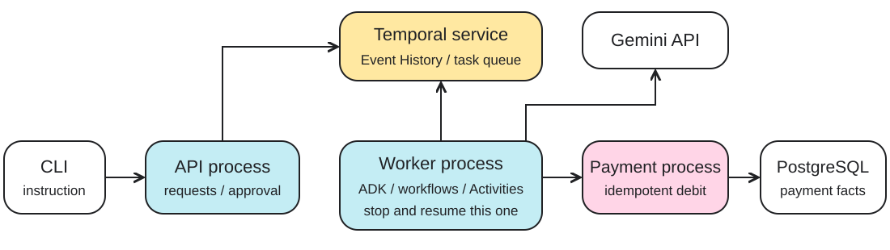

<!-- _class: title -->
# Building a Durable<br>AI Payment Agent

## Gemini + Temporal · Go · PostgreSQL

**Google DevFest Ibadan 2026**

From natural-language instructions to confirmed, recoverable payments.

<!-- Speaker notes: 0:00–0:30. All payments are simulated. We extend a supplied working agent rather than building every infrastructure component from scratch. Presenter name and event date intentionally omitted. The visual theme adapts the supplied DevFest 2026 intro deck, especially pages 7, 11 and 12. -->

---
# Watch one payment work

> “Send ₦10,000 to Ayomide.”
>
> “Send ₦10,000 to Ayomide — GTBank ending in 4821?”
>
> “Yes.” → **Transfer successful. TX-…**

**What if the payment succeeds, but its response disappears?**

<!-- 0:30–4:00. Opening demo on main in the presenter environment. See docs/presenter.md. Show ask, wait, approve, wait --terminal. Use the actual returned reference. No failure yet. If live infrastructure is unavailable use dist/fallback/opening.png and the saved JSON from make demo. -->

---
# What you will build and explore

- Extend a working **Go payment agent**.
- Implement **beneficiary creation** in ten minutes.
- Use existing listing, search, balance and payment tools.
- Inspect dynamic tool dispatch and worker recovery.
- Verify **one debit** after a lost response.

<!-- 4:00–5:00. Establish the learner contract. Authentication is simplified to one fixed local account. Participant and presenter environments are separate. Search is implemented beforehand. -->

---
# Four responsibilities. Two workflows.



**Request → agent workflow → proposal → approval → payment workflow**

Gemini proposes. Go validates and controls. Temporal preserves progress.

<!-- 5:00–7:00. The agent workflow starts before reasoning; the payment child workflow starts only after approval. The simulated payment service owns PostgreSQL. Temporal has its own separate development persistence. No direct database/network I/O in workflow code. -->

---
# Validation and confirmation are different

| Runs without an additional prompt | Requires explicit approval |
|---|---|
| Add, list, search and find beneficiaries | Send money |
| Read balance and transaction status | Send a replacement after definitive failure |
| Prepare a payment proposal | |

**Every tool is validated.** Saving a beneficiary does not approve a payment.

<!-- 7:00–8:30. The original add instruction requests a mutation; it does not need another yes/no prompt. Invalid inputs are never executed. A valid saved beneficiary remains saved if a later transfer is rejected. -->

---
# Gemini requests. Go executes.

```json
{
  "name": "find_beneficiary",
  "args": {"name": "Ayomide"}
}
```

**Decode → validate → allowed handler → result back to ADK**

Tool selection does not authorize payment.

<!-- 8:30–10:00. Inspect the tool catalog and function declaration, not hidden chain of thought. ADK drives the model/tool loop. The model cannot call the internal SubmitTransfer Activity. Prompt instructions help interpretation; runtime checks enforce the boundary. -->

---
# Static versus Dynamic Activities

| Static registration | Dynamic registration |
|---|---|
| Register individual implementations | Register one fallback dispatcher |
| SDK selects the registered implementation | Dispatcher selects an allowed tool handler |
| SDK decodes typed arguments | Dispatcher chooses the argument type |

Both use retries, timeouts and recorded results.<br>
**Calling by name alone is not dynamic registration.**

<!-- 10:00–12:00. Show RegisterDynamicActivity in cmd/devfest/main.go. Tool names are not individually registered. Model calls and internal payment Activities are statically registered and are not model-accessible tools. Source: https://docs.temporal.io/develop/go/activities/dynamic-activity -->

---
# Dynamic dispatch in Go

```go
func (r *Router) Execute(
    ctx context.Context,
    args converter.EncodedValues,
) (any, error) {
    name := activity.GetInfo(ctx).ActivityType.Name
    return r.decodeValidateAndRun(ctx, name, args)
}
```

**Name → allowlist → decode → validate → handler**

<!-- 12:00–14:00. This is condensed pseudocode for Execute plus dispatch in internal/agent/tools.go. Unknown names fail non-retryably. Show the actual implementation and strict decoding. The fallback is not unrestricted execution. Catalog ordering is deterministic. -->

---
# Durable progress and replay

- **Workflows:** deterministic decisions, timers and approval waits.
- **Activities:** Gemini calls and external I/O.
- Recorded results reconstruct progress after a worker restart.
- A call without a recorded completion **may run again**.

> Durability reduces repeated calls.<br>Idempotency protects repeated mutations.

<!-- 14:00–17:00. Ordinary in-memory progress disappears on crash. Temporal re-executes workflow code using Event History. Do not promise zero repeated token charges. Completed Activity replay does not re-invoke its model call. Source: https://docs.temporal.io/workflows -->

---
# One payment. One financial effect.

**Multiple attempts → one payment key → one debit**

- Stable key for submissions and reconciliation.
- Atomic funds check, debit and journal entry in PostgreSQL.
- A timeout does not prove failure.
- A known outcome, or explicitly unresolved status.

<!-- 17:00–20:00. Show PaymentWorkflow and Store.Submit briefly. PostgreSQL enforces the financial effect; Temporal preserves the process. A decline is a valid terminal outcome. Avoid claims of guaranteed successful payment, production security or measured scale. -->

---
<!-- _class: practice -->
# Start from the exercise checkpoint

```bash
git switch -c my-beneficiary workshop/02-beneficiary-exercise
source scripts/env.sh
make build && make preflight
make start
```

Existing **listing and search already work**.<br>
Guide: `docs/beneficiary-exercise.md`

<!-- 20:00–21:00. Preflight/setup happens BEFORE the event. Use another terminal for CLI commands, source the same instance/checkpoint environment. Save work before switching. Do not run git reset/clean. If a learner falls behind, commit their work and start a new branch from workshop/03-beneficiary-solution. -->

---
<!-- _class: practice -->
# Practice: add Ayomide

> “Add Ayomide at GTBank, account 0123454821.”

1. Implement the typed Go handler.
2. Add its tool-catalog entry.
3. Run the acceptance checks.
4. Ask the agent, then **search/list to verify**.

**Halfway hint and full code:** `docs/beneficiary-exercise.md`

<!-- 21:00–27:00. Service endpoint, typed client, validation and PostgreSQL storage are supplied. Participants wire the tool, not database infrastructure. At halfway show the hint. No static RegisterActivity call is needed. Observe the dynamic add_beneficiary Activity. The newly added beneficiary is used in the next payment. -->

---
<!-- _class: practice -->
# Prove the validation

| Input | Expected result |
|---|---|
| `"0123454821"` | Valid; leading zero preserved |
| `"123454821"` | Rejected: nine digits |
| Numeric JSON account number | Rejected: wrong type |
| Repeated identical addition | Existing beneficiary returned |
| Invalid direct service request | Rejected independently |

**Dispatcher → service → database constraints**

<!-- 27:00–30:00. Run make exercise-check and the direct curl example in the guide. Exactly 10 ASCII digits, no padding/truncation/whitespace repair. Format validation is not real bank verification. Invalid operations make no mutation; previous successful operations remain committed. -->

---
<!-- _class: recovery -->
# Use the beneficiary. Restart the worker.

1. Prepare a payment to **Ayomide**.
2. Stop the worker while approval is pending.
3. Restart it and retrieve the **same proposal**.
4. Approve and complete the payment.

Inspect the same workflow/proposal and pre-restart model invocations.

<!-- 30:00–40:00. Presenter environment runs completed main independently of learners. Use docs/presenter.md or make demo. Snapshot model audit lines before shutdown and after restart BEFORE approving; no pre-existing completed calls may be invoked again. Later operations/narration can legitimately introduce new calls. If infrastructure fails use fallback recording/screenshots, clearly identified as recorded. -->

---
<!-- _class: recovery -->
# Lose the payment response

1. The provider commits the debit.
2. The HTTP connection closes before the response arrives.
3. The payment workflow checks the **original key**.
4. The existing successful payment is returned.

Inspect **key · reference · balance change · one journal entry**.

<!-- 40:00–46:00. This is an actual connection loss after PostgreSQL commit, not just a pretend error string. Activity retries do not imply exactly-once external execution. The payment service's unique key and transaction protect the debit. Compare evidence before/after this one scenario; previous demos may already have debits. -->

---
# Retry according to the operation

| Operation | Recovery |
|---|---|
| Model call or read tool | Bounded transient-failure retries |
| Beneficiary creation | Idempotent creation |
| Payment uncertainty | Same key, status reconciliation |
| Invalid input or definitive decline | Return the outcome |

Retry a failed transfer only with a **new proposal and fresh approval**.

<!-- 46:00–48:00. Demonstrate last transfer lookup briefly. Successful/pending/unknown payments cannot automatically become replacement payments. Explain needs_attention and the explicit status-only reconcile command. Failure examples beyond the core go in the appendix/runbook. -->

---
<!-- _class: takeaway -->
# Follow the evidence

- Duplicate beneficiary addition → **one beneficiary**.
- Rejected proposal → **no payment submission**.
- Worker restart → **recorded results reused**.
- Lost response → **one debit**.

> Gemini proposes. Go validates and controls.<br>Temporal preserves progress. The payment service enforces the financial effect.

<!-- 48:00–50:00. Repeat the README's core message: The LLM should decide what it wants to do; the application decides what it is allowed to do; Temporal coordinates reliable completion. Reliable completion includes definitive failure or explicitly unresolved outcomes, not guaranteed success. -->

---
<!-- _class: title -->
# Continue practising

- **Notifications:** retry delivery without repeating payment.
- **Scheduled transfers:** durable timers and execution-time checks.
- Explore provider and database outages.

Guides and independent starter/solution branches are in `docs/`.

**Questions · 10 minutes**

<!-- 50:00–60:00. References in the appendix. Notifications are local simulated receipts, not real messages. Schedules require confirmation of recipient, amount and exact execution time. No production security or benchmark claim. -->

---
<!-- _class: appendix -->
# Appendix · Temporal's execution model

- Temporal originated as a fork of Uber's Cadence.
- Event History records workflow execution events.
- Replay reconstructs progress rather than restoring a process snapshot.
- SDKs provide replay-aware primitives; business rules remain your code.

[Temporal workflows](https://docs.temporal.io/workflows) · [Cadence origins](https://github.com/temporalio/temporal)

<!-- Optional material. Do not imply the SDK implements application quorum rules or automatic business compensation. -->

---
<!-- _class: appendix -->
# Appendix · APIs, agent SDKs and durability

- Direct Gemini/OpenAI API: inference and tool-call responses.
- ADK/Agents SDK: agent and tool orchestration.
- Temporal: durable execution around model calls and operations.
- This workshop implements **Gemini + ADK in Go**.

[Temporal ADK integration](https://github.com/temporalio/ai-integrations/tree/main/go/googleadk)<br>
[Official OpenAI agent documentation](https://developers.openai.com/api/docs/guides/agents)

---
<!-- _class: appendix -->
# Appendix · Sources and further watching

- [Video 1](https://www.youtube.com/watch?v=k8cnVCMYmNc) · [transcript page](https://ai.engineer/talks/k8cnVCMYmNc)
- [Tom Wheeler: determinism, replay and durable execution](https://www.youtube.com/watch?v=89WOM-kV7Ws)
- [Temporal Dynamic Activities — Go](https://docs.temporal.io/develop/go/activities/dynamic-activity)
- [PostgreSQL locking](https://www.postgresql.org/docs/17/explicit-locking.html)

<small>The first transcript page was inaccessible during preparation. The supplied second-video text is a description. Technical explanations use official documentation.</small>

<!-- User-provided DevFest 2026 Intro Slides PDF is the visual reference, not the workshop content. -->
