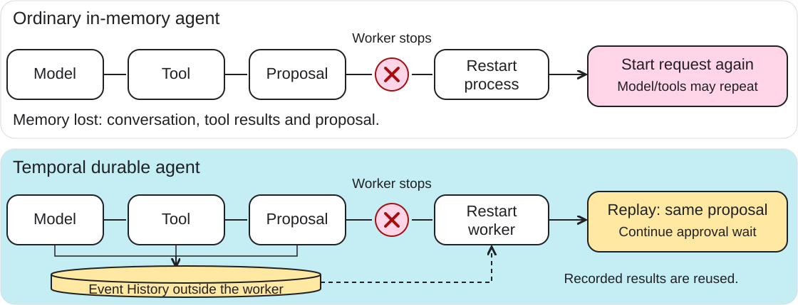

<!-- _class: title -->
# Building a Durable<br>AI Payment Agent

## Gemini + Temporal · Go · PostgreSQL

**Google DevFest Ibadan 2026**

From natural-language instructions to confirmed, recoverable payments.

---
<!-- _class: title intro -->
# Soetan Ayobami

## Software Engineer

[GitHub · @Roisholto](https://github.com/Roisholto)

Today: **Go · AI agents · durable execution**

---
<!-- _class: practice -->
# Get the workshop code

<div class="promotion-layout">
<div class="promotion-copy">
<p class="repository-link"><a href="https://github.com/Roisholto/devfest26">github.com/Roisholto/devfest26</a></p>
<pre><code>git clone https://github.com/Roisholto/devfest26.git
cd devfest26</code></pre>
<p>Setup guide: <a href="https://github.com/Roisholto/devfest26/blob/main/docs/setup.md">docs/setup.md</a></p>
<p>Or choose <strong>Code → Download ZIP</strong> on GitHub.</p>
</div>
<a class="repository-qr" href="https://github.com/Roisholto/devfest26">

<span>Scan for code and setup</span>
</a>
</div>

---
# Watch one payment work

> “Send ₦10,000 to John.”
>
> “Send ₦10,000 to John — Access ending in 5678?”
>
> “Yes.” → **Transfer successful. TX-…**

**What if the payment succeeds, but its response disappears?**

---
# What you will build and explore

- Extend a working **Go payment agent**.
- Implement **beneficiary creation** in ten minutes.
- Use existing listing, search, balance and payment tools.
- Inspect dynamic tool dispatch and agent recovery.
- Verify **one debit** after a lost response.

---
# Meet Temporal

**A platform for durable execution of application code.**

- **Workflow:** coordinates steps, approval waits and timers.
- **Activity:** performs external work, including Gemini and tool calls.
- **Worker:** your Go process that polls and executes that code.
- **Service:** records Event History and schedules pending work.

A Workflow can outlive the worker process that executes it.

---
# Same agent. Different recovery.

| After the process stops | Ordinary in-memory agent | With Temporal |
|---|---|---|
| Conversation and tool results | Lost unless you persist them | Rebuilt from Event History |
| Proposal and approval wait | Application must recover them | Same Workflow ID and proposal |
| Completed model/tool calls | May repeat on a fresh run | Recorded completions reused |
| External mutations | Need idempotency | Still need idempotency |

**Without durable execution:** recovery is application work.

---
<!-- _class: visual -->
# Stop the worker. What survives?



<small>Unrecorded completions may retry. Payment effects still need idempotency.</small>

---
# Three Go processes. Two workflows.


**Request → agent workflow → proposal → approval → payment workflow**

Gemini proposes. Go validates and controls. Temporal preserves progress.

---
# Validation and confirmation are different

| Runs without an additional prompt | Requires explicit approval |
|---|---|
| Add, list, search and find beneficiaries | Send money |
| Read balance and transaction status | Send a replacement after definitive failure |
| Prepare a payment proposal | |

**Every tool is validated.** Saving a beneficiary does not approve a payment.

---
# Gemini requests. Go executes.

```json
{
  "name": "find_beneficiary",
  "args": {"name": "John"}
}
```

**Decode → validate → allowed handler → result back to ADK**

Tool selection does not authorize payment.

---
# Static versus Dynamic Activities

| Static registration | Dynamic registration |
|---|---|
| Register individual implementations | Register one fallback dispatcher |
| SDK selects the registered implementation | Dispatcher selects an allowed tool handler |
| SDK decodes typed arguments | Dispatcher chooses the argument type |

Both use retries, timeouts and recorded results.<br>
**Calling by name alone is not dynamic registration.**

---
# Dynamic dispatch in Go

```go
func (r *ToolDispatcher) Execute(
    ctx context.Context,
    args converter.EncodedValues,
) (any, error) {
    name := activity.GetInfo(ctx).ActivityType.Name
    return r.decodeValidateAndRun(ctx, name, args)
}
```

**Name → allowlist → decode → validate → handler**

---
# Durable progress and replay

- **Workflows:** deterministic decisions, timers and approval waits.
- **Activities:** Gemini calls and external I/O.
- Recorded results reconstruct progress after a worker restart.
- A call without a recorded completion **may run again**.

> Durability reduces repeated calls.<br>Idempotency protects repeated mutations.

---
# One payment. One financial effect.

**Multiple attempts → one payment key → one debit**

- Stable key for submissions and reconciliation.
- Atomic funds check, debit and journal entry in PostgreSQL.
- A timeout does not prove failure.
- A known outcome, or explicitly unresolved status.

---
<!-- _class: practice -->
# Stay on main. Extend one tool.

```bash
make setup
make payment  # its own terminal
make api      # another terminal
make worker   # another terminal
# After editing: Ctrl-C, then make worker
```

Existing **listing and search already work**.<br>
Guide: `docs/beneficiary-exercise.md`

---
<!-- _class: practice -->
# Practice: add Ayomide

> “Add Ayomide at GTBank, account 0123454821.”

1. Add the declaration to `Catalog()` in `tools.go`.
2. Implement `AddBeneficiary` in `beneficiary.go`.
3. Run the acceptance checks.
4. Ask the agent, then **search/list to verify**.

**Halfway hint and full code:** `docs/beneficiary-exercise.md`

---
<!-- _class: practice -->
# Prove the validation

| Input | Expected result |
|---|---|
| `"0123454821"` | Valid; leading zero preserved |
| `"123454821"` | Rejected: nine digits |
| Numeric JSON account number | Rejected: wrong type |
| Repeated identical addition | Existing beneficiary returned |
| Invalid direct service request | Rejected independently |

**Dispatcher → service → database constraints**

---
<!-- _class: recovery -->
# Use the beneficiary. Stop the worker.

1. Prepare a payment to **Ayomide**.
2. Stop only the worker while approval is pending.
3. Run `make worker`; retrieve the **same proposal**.
4. Approve and complete the payment.

The API stays up. Pending work waits in Temporal.<br>Inspect the same proposal and completed model-call counts.

---
<!-- _class: recovery -->
# Lose the payment response

1. The provider commits the debit.
2. The HTTP connection closes before the response arrives.
3. The payment workflow checks the **original key**.
4. The existing successful payment is returned.

Inspect **key · reference · balance change · one journal entry**.

---
# Retry according to the operation

| Operation | Recovery |
|---|---|
| Model call or read tool | Bounded transient-failure retries |
| Beneficiary creation | Idempotent creation |
| Payment uncertainty | Same key, status reconciliation |
| Invalid input or definitive decline | Return the outcome |

Retry a failed transfer only with a **new proposal and fresh approval**.

---
<!-- _class: takeaway -->
# Follow the evidence

- Duplicate beneficiary addition → **one beneficiary**.
- Rejected proposal → **no payment submission**.
- Worker restart → **recorded results reused**.
- Lost response → **one debit**.

> Gemini proposes. Go validates and controls.<br>Temporal preserves progress. The payment service enforces the financial effect.

---
<!-- _class: title -->
# Continue practising

- **Notifications:** retry delivery without repeating payment.
- **Scheduled transfers:** durable timers and execution-time checks.
- Explore provider and database outages.

Written exercises and solution snippets are in `docs/`.

---
<!-- _class: promotion -->
# Explore my open-source work

<div class="promotion-layout">
<div class="promotion-copy">
<h2>netlify-load-external-files</h2>
<p>Load external files during a Netlify build.</p>
<p><strong>Explore the repo and give it a star.</strong></p>
<p class="repository-link"><a href="https://github.com/Roisholto/netlify-load-external-files">github.com/Roisholto/<br>netlify-load-external-files</a></p>
<p class="questions">Questions · 10 minutes</p>
</div>
<a class="repository-qr" href="https://github.com/Roisholto/netlify-load-external-files">

<span>Scan to open GitHub</span>
</a>
</div>

---
<!-- _class: appendix -->
# Appendix · Temporal's execution model

- Temporal originated as a fork of Uber's Cadence.
- Event History records workflow execution events.
- Replay reconstructs progress rather than restoring a process snapshot.
- SDKs provide replay-aware primitives; business rules remain your code.

[Temporal workflows](https://docs.temporal.io/workflows) · [Cadence origins](https://github.com/temporalio/temporal)

---
<!-- _class: appendix -->
# Appendix · APIs, agent SDKs and durability

- Direct Gemini/OpenAI API: inference and tool-call responses.
- ADK/Agents SDK: agent and tool orchestration.
- Temporal: durable execution around model calls and operations.
- This workshop implements **Gemini + ADK in Go**.

[Google ADK documentation](https://adk.dev/) · [Go quickstart](https://adk.dev/get-started/go/)<br>
[Temporal ADK integration](https://github.com/temporalio/ai-integrations/tree/main/go/googleadk)<br>
[Official OpenAI agent documentation](https://developers.openai.com/api/docs/guides/agents)

---
<!-- _class: appendix -->
# Appendix · Sources and further watching

- [Cornelia Davis: building durable agents with OpenAI SDK and Temporal](https://www.youtube.com/watch?v=k8cnVCMYmNc)
- [Tom Wheeler: determinism, replay and durable execution](https://www.youtube.com/watch?v=89WOM-kV7Ws)
- [Google ADK documentation](https://adk.dev/) · [Go quickstart](https://adk.dev/get-started/go/)
- [Temporal documentation](https://docs.temporal.io/) · [Go SDK guide](https://docs.temporal.io/develop/go)
- [Workflows and replay](https://docs.temporal.io/workflows) · [Activities](https://docs.temporal.io/activities)
- [Dynamic Activities in Go](https://docs.temporal.io/develop/go/activities/dynamic-activity)
- [PostgreSQL locking](https://www.postgresql.org/docs/17/explicit-locking.html)
